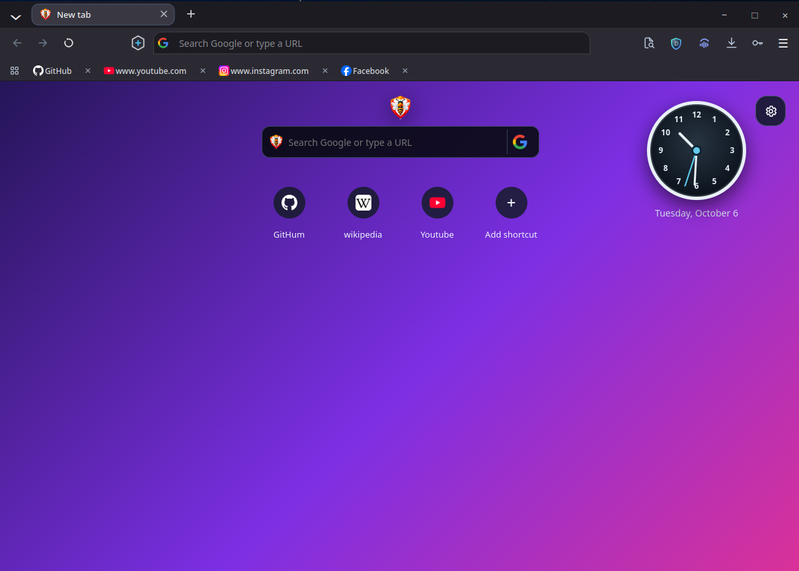
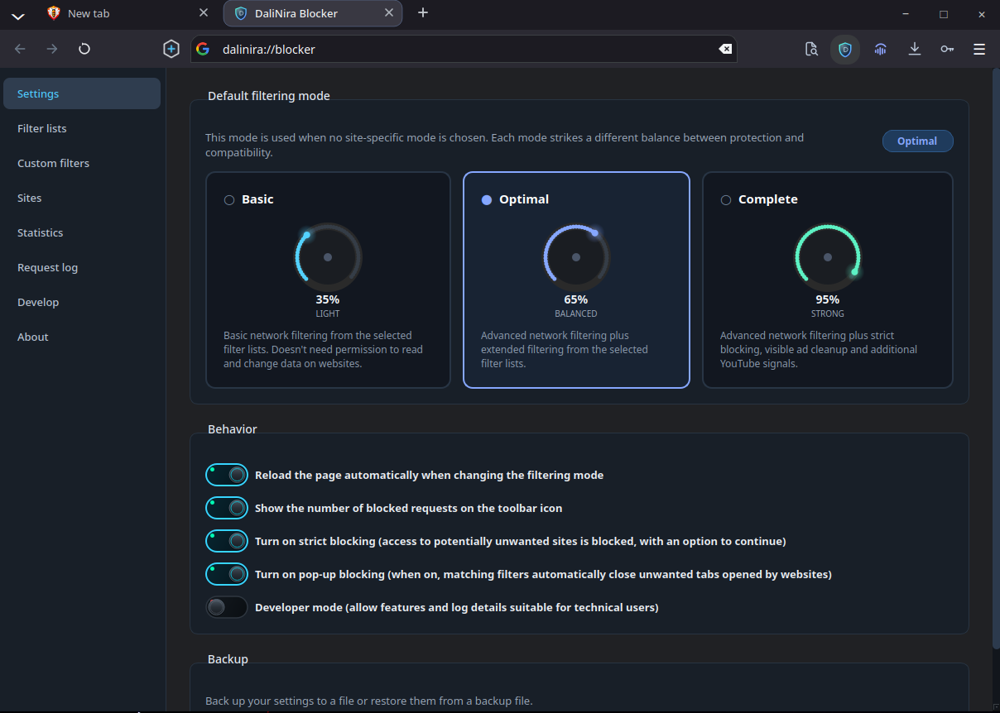
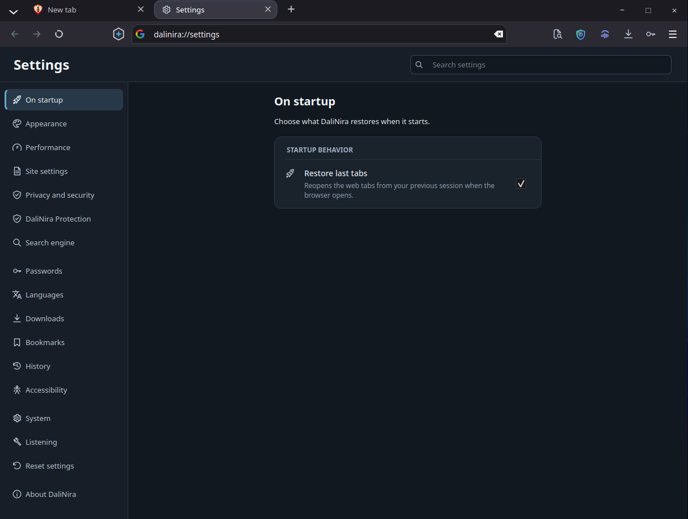
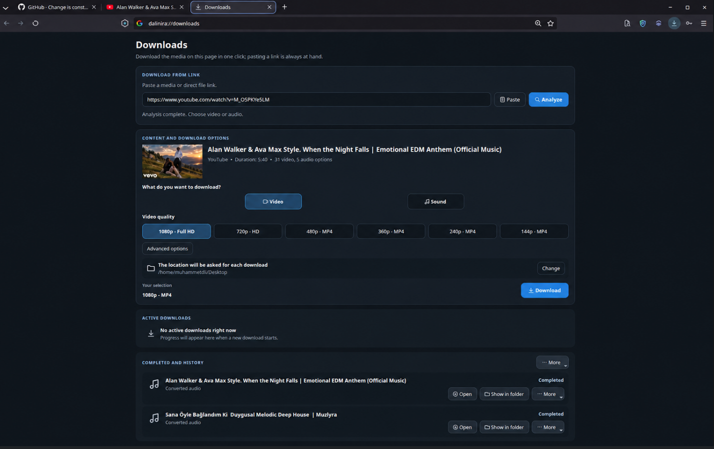
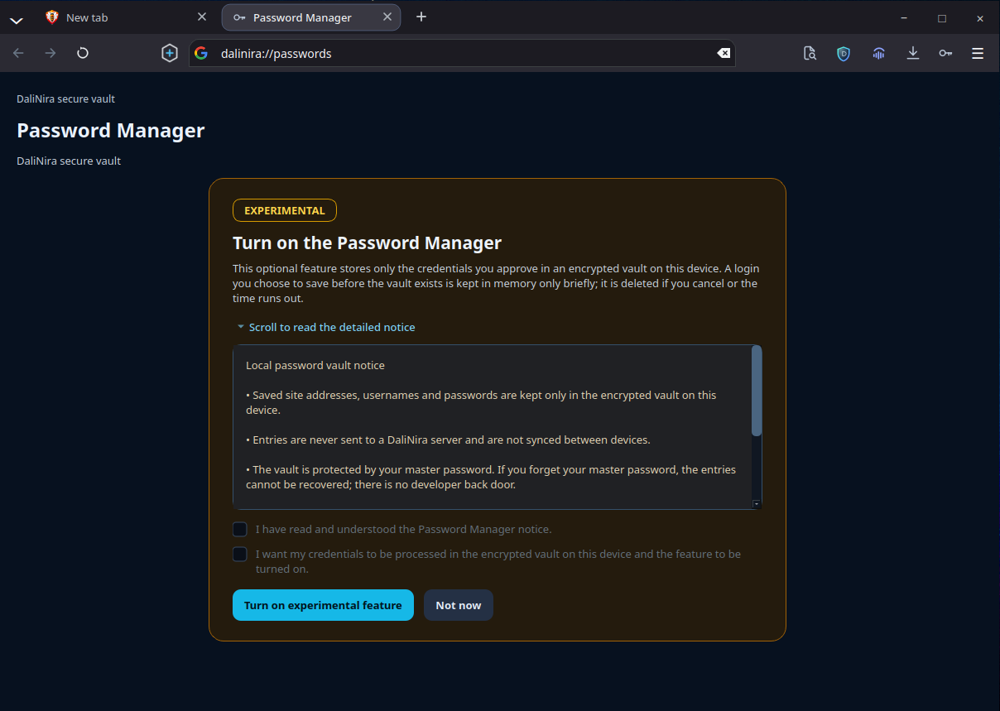
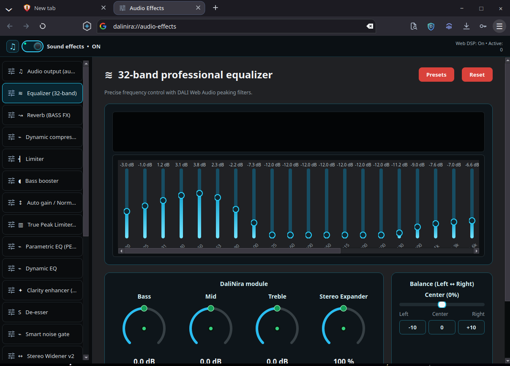
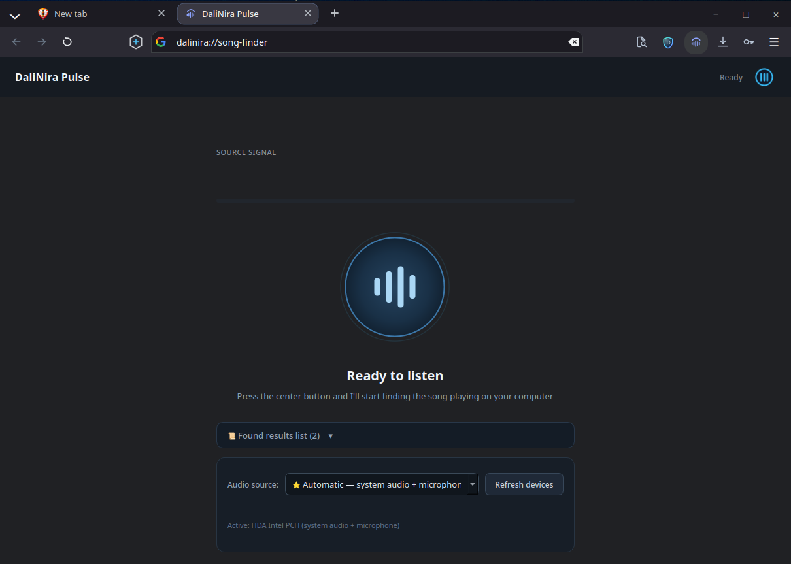

<p align="center">
  
</p>

<h1 align="center">DaliNira Browser</h1>

<p align="center">
  A native Linux desktop browser with two engines — Chromium and WebKitGTK — behind one interface, with built-in ad and tracker blocking and a local-first design.
</p>

<p align="center">
  <a href="https://github.com/Muhammed-Dali/DaliNira-Browser/releases/tag/v8.0.2"></a>
  <a href="https://github.com/Muhammed-Dali/DaliNira-Browser/actions/workflows/ci.yml"></a>
  <a href="LICENSE"></a>
  
  
  
</p>

<p align="center">
  <a href="https://github.com/Muhammed-Dali/DaliNira-Browser/releases">Download</a> ·
  <a href="https://muhammed-dali.github.io/DaliNira-Browser/">Website</a> ·
  <a href="docs/RELEASE_NOTES_v8.0.2.md">Release notes</a> ·
  <a href="CHANGELOG.md">Changelog</a>
</p>

<p align="center">
  
</p>

## What is DaliNira?

DaliNira is an independent desktop browser for Linux, written in C++20 and
Qt 6. It builds in features that usually need several extensions: ad and
tracker blocking, page translation, a download manager, a password vault and
an audio equalizer. Your data stays on your computer, and no account is
needed.

DaliNira 8.0 is a dual-engine browser. One DaliNira application contains two
complete browser engines:

- **Chromium**, through Qt WebEngine;
- **WebKitGTK**, through DaliNira's own patched build of WebKitGTK 2.54.1.

Both engines share the same interface, settings and browser features. You
choose the engine during onboarding or in **Settings → System**.

## What's new in 8.0

- **Dual engine:** Chromium and WebKitGTK in one application, each with its
  own tabs and session.
- **Privacy:** a reworked native ad and tracker blocker, tracking-parameter
  stripping, link debouncing, HTTPS by default, Global Privacy Control and
  fingerprinting protection, all in both engines.
- **Onboarding:** a first-run flow for language, engine, layout, theme,
  search engine, privacy options and importing data from other browsers.
- **Keyboard Shortcuts:** customizable bindings with conflict detection and
  reset.
- **Side tabs:** vertical tabs on the left or right, or a floating sidebar,
  with optional auto-hiding and a pin button.
- **Tab sleeping:** inactive tabs sleep in two stages to save memory.
- **Localization:** English, Turkish, Arabic and, new in this release,
  French. The catalog grew from 209 to 2,128 strings.
- **Stability:** the WebKit engine runs on a private WebKitGTK runtime with a
  validated fix for a web-process crash. See
  [WebKit stability work](#webkit-stability-work).

The full list is in the [release notes](docs/RELEASE_NOTES_v8.0.2.md).

## Two engines

Switching the engine restarts the browser and opens that engine's own set of
tabs. Each engine keeps its own open tabs, session, Quick Access shortcuts and
frequent sites. Bookmarks, theme, language, search engine, blocker settings
and downloads are shared by both engines.

|                     | Chromium (Qt WebEngine)                 | WebKitGTK (private runtime)                 |
|---------------------|-----------------------------------------|---------------------------------------------|
| Interface, menus, find bar, translation, blocker, downloads, shortcuts, side tabs | Shared | Shared |
| Tabs and session    | Own workspace                           | Own workspace                               |
| Wayland             | Native Wayland                          | Through XWayland                            |
| Cache partitioning  | HTTP cache per top-level site¹          | Not available (single cache)                |
| Light tab sleep     | Page frozen                             | Hidden page throttled                       |
| Save page           | Complete web page                       | Saved as PDF                                |
| Third-party cookies | Blocked                                 | Blocked (cookie policy and ITP); no per-site exceptions |

¹ A third-party frame that is open in another tab can reuse that tab's renderer
process, and Chromium's in-memory resource cache there is not partitioned.

Automated parity tests run the same scenarios on both engines and compare the
results. The scenarios cover popups, scripts, media, layout, privacy, network,
fingerprinting, find in page, translation, keyboard shortcuts and side tabs.

### The WebKitGTK runtime

DaliNira does not use the system's WebKitGTK for its release runtime. Release
packages install DaliNira's own build of WebKitGTK 2.54.1, with one patch,
under `/usr/lib/dalinira-browser/webkit/`:

- Only DaliNira loads this copy. The system's `webkit2gtk-4.1` is not needed,
  replaced or changed, and no environment variable is involved.
- The browser and every runtime binary use `DT_RPATH`, which takes precedence
  over `LD_LIBRARY_PATH`. A user's environment therefore cannot swap in another
  WebKitGTK.
- At startup DaliNira checks which WebKitGTK libraries it loaded. If an
  installation is broken and not on its private runtime, DaliNira starts with
  Chromium instead of running WebKit on a system copy.
- `dalinira-browser --check-webkit-runtime` prints which WebKitGTK is in use.
- The runtime's licenses, the patch and a source notice are installed in
  `/usr/share/doc/dalinira-browser/webkitgtk/`. The complete source is
  published with each release as `dalinira-webkit-runtime-source-8.0.2.tar`.

The runtime layout and build are described in
[packaging/webkit-runtime/README.md](packaging/webkit-runtime/README.md).

## Features

### Ad and tracker protection

<p align="center">
  
</p>

The DaliNira blocker is a native C++ filter engine that runs in both engines.
On WebKitGTK it filters requests through a web process extension. It applies
EasyList, EasyPrivacy, Peter Lowe's list, AdGuard and regional lists locally,
and it hides empty ad containers with cosmetic filtering. Protection modes
(Basic, Optimal, Complete), list selection and per-site exceptions are on
`dalinira://blocker`.

Other privacy protections in both engines:

- **Tracking-parameter stripping:** parameters such as `utm_*`, `fbclid` and
  `gclid` are removed from URLs in a single step, using an extended built-in
  list.
- **Link debouncing:** known redirect wrappers go straight to their
  destination, unless the destination itself would be blocked.
- **Fingerprinting protection:** per-site, per-session noise for canvas,
  WebGL, audio and several hardware values.
- **HTTPS by default** for top-level navigations to public hosts, with a
  one-time fallback to HTTP for sites that do not support it.
- **Global Privacy Control:** the `Sec-GPC` header and
  `navigator.globalPrivacyControl`.
- **Third-party cookie blocking.** In Chromium, the HTTP cache and network
  connections are also partitioned by top-level site.

### Side tabs

DaliNira has four layouts: classic tabs, vertical side tabs on the left or
right, and a floating sidebar. The side-tab layouts include an auto-hide mode:

- **New Tab:** the side tabs stay visible on the New Tab page.
- **Websites:** the side tabs slide away, so the page gets the full window
  width.
- **Edge hover:** moving the pointer to the window edge brings the tabs back
  as an overlay, without relaying out the page.
- **Pin and unpin:** the pin button in the panel keeps the tabs open or lets
  them hide again. The same setting is under **Settings → Appearance →
  Auto-hide side tabs**. Left and right layouts stay pinned by default, and
  the floating sidebar hides by default.
- **Background-aware look:** beside the New Tab page, the panel shows a
  blurred and tinted copy of the page's background.
- **Fullscreen and dragging:** fullscreen always hides the panel, and the
  panel never hides while you drag a tab.

Auto-hide behaves the same way on Chromium and WebKitGTK.

### Keyboard Shortcuts

**Settings → Keyboard Shortcuts** lists the browser's actions in groups, such
as windows and tabs, navigation, find and page actions.

- **Custom bindings:** click a shortcut and press the new key combination.
- **Conflict detection:** if a combination is already in use, DaliNira names
  the action that has it and offers to reassign it. Text-editing keys such as
  Ctrl+C, Ctrl+V and Ctrl+Z, and window-manager keys such as Alt+F4, are
  reserved.
- **Reset:** reset one shortcut to its default, or reset all shortcuts at
  once.
- **Live updates:** changes take effect immediately in every open window,
  without a restart.
- **Both engines:** the same bindings work on Chromium and WebKitGTK pages.

### Tab sleeping

Background tabs first go into light sleep, then release their memory after a
longer idle period or under memory pressure. You can also put a tab to sleep
or wake it from the tab menu. Tabs with unsaved form input are never released
automatically. The hover card shows a tab's memory use when it can be measured
exactly.

### Find in page, translation, PDF and saving pages

- **Find in page:** press **Ctrl+F** or use the toolbar button. Enter and
  Shift+Enter, F3 or Ctrl+G move between matches.
- **Page translation:** when a page is in another language, the translation
  popup offers to translate it in place without blocking the page. The
  providers are Google, Google Cloud, DeepL and LibreTranslate.
- **Save as PDF** works in both engines. **Save page as** saves the complete
  page in Chromium; in WebKitGTK it saves the page as a PDF.

### Onboarding, settings and languages

<p align="center">
  
</p>

On first launch, onboarding walks through the interface language, the engine,
the layout and theme, the search engine, privacy options and importing data
from other browsers.

All settings are on one page (`dalinira://settings`), grouped in a sidebar
from startup and appearance to privacy, keyboard shortcuts, languages and the
browser engine. The interface is translated into English, Turkish, Arabic and
French, and you can change the language without restarting. The browser chrome
stays left-to-right in every language.

### Downloads, passwords and media

<p align="center">
  
  
</p>
<p align="center">
  
  
</p>

- **Downloads:** segmented parallel downloads with resume and retries, plus
  media analysis for supported sites (`dalinira://downloads`).
- **Password Manager:** an opt-in local vault. Credentials are encrypted with
  AES-256-GCM and a PBKDF2-HMAC-SHA256 key, and the vault is never
  synchronized to a server. Saved logins can be filled on sign-in forms in
  both engines (`dalinira://passwords`).
- **Audio effects:** a 32-band equalizer, compressor, limiter, stereo widener,
  reverb and 1,757 AutoEQ headphone presets. They apply to web media on
  supported sites such as YouTube in both engines
  (`dalinira://audio-effects`).
- **Pulse:** identifies the song playing on your computer. Pulse builds an audio
  fingerprint locally and sends only that fingerprint to Shazam's recognition
  service.

### Feedback

**Settings → About DaliNira → Feedback** links to the GitHub bug-report and
feature-request forms. **Send Email** opens a draft in your own mail
application, addressed to the project, with a short problem-report template,
the DaliNira version and the active engine; nothing is sent until you press
Send. None of these include the current page, browsing history, account data or
logs.

## Privacy principles

- **Local first:** history, bookmarks, passwords, settings and audio presets
  are stored in your user profile on your computer.
- **No account and no built-in telemetry.**
- **Network services are used only for the features that need them:** search
  suggestions from your chosen search engine, translation from the provider
  you select, Pulse recognition, and filter-list updates.
- **Private windows** use a separate profile that is not written to disk.

See [SECURITY.md](SECURITY.md) for the security model and how to report
vulnerabilities.

## Known issues

- Packages built against Qt older than 6.8 have fewer privacy and
  settings features: the Debian 12 and Ubuntu 24.04 `.deb` packages and the portable
  archive are built against Qt 6.4, and the Arch binary packages (pacman
  repository, AUR `dalinira-bin`) repackage the portable archive. These builds
  have no Secure DNS setting (Qt 6.6), no list of saved site permissions (Qt 6.8;
  permission prompts still work), do not remove the OS version from client
  hints (Qt 6.8), and follow the system light/dark theme only through the
  palette (Qt 6.5). The Fedora `.rpm` and the Arch source package
  (`packaging/archlinux`) are built against current Qt and have all features.
- **WebKitGTK: fullscreen `<video>` element freezes.** When the `<video>`
  element itself is made fullscreen, the video stops advancing until
  fullscreen ends. This happens with the native video controls' fullscreen
  button and with pages that call `requestFullscreen()` on the video element.
  It is upstream WebKitGTK 2.54.1 behavior and also happens in plain
  WebKitGTK on X11 and Wayland. Sites that make their player container
  fullscreen, as YouTube does, work normally. Windowed playback and the
  Chromium engine are not affected.
- WebKitGTK uses one network cache and connection pool, and it offers no API
  to partition them by site.
- In WebKitGTK, light sleep throttles hidden pages but does not freeze them.
  Full sleep releases the page in both engines.
- Per-site cookie exceptions are not available on WebKitGTK, whose cookie
  policy is global.

## Installation

DaliNira supports Linux x86_64. The 8.0.2 release workflow is configured to
publish these packages on the
[Releases page](https://github.com/Muhammed-Dali/DaliNira-Browser/releases):

| Package                                         | Distribution       |
|-------------------------------------------------|--------------------|
| `dalinira-browser_8.0.2-1.debian12_amd64.deb`   | Debian 12          |
| `dalinira-browser_8.0.2-1.ubuntu2404_amd64.deb` | Ubuntu 24.04       |
| `dalinira-browser-8.0.2-1.fcNN.x86_64.rpm`      | Fedora             |
| `dalinira-browser-8.0.2-linux-x86_64.tar.zst`   | Portable archive   |

Each package is built to include the private WebKitGTK runtime, so no system
WebKitGTK setup is needed.

> **Release status:** the Arch Linux source package (`packaging/archlinux`)
> has been built and validated locally from a staged install, including the
> private runtime. The `.deb`, `.rpm`, portable and Arch binary packages are
> configured in the release workflow, which installs and checks each native
> package in a clean container before publishing; until that has run, treat
> them as not yet release-validated.

Install a downloaded package with your package manager, for example `sudo apt install ./dalinira-browser_8.0.2-1.debian12_amd64.deb` or
`sudo dnf install ./dalinira-browser-8.0.2-1.fc*.x86_64.rpm`.

### Arch Linux

From the AUR:

```bash
yay -S dalinira-bin
```

Or from the signed DaliNira pacman repository (key
`BC741FD0AC804351B0DDBB86FDFEC60C11202588`):

```bash
curl -sL https://muhammed-dali.github.io/DaliNira-Browser/dalinira.gpg | sudo pacman-key --add -
sudo pacman-key --lsign-key BC741FD0AC804351B0DDBB86FDFEC60C11202588
echo -e "\n[dalinira]\nSigLevel = Required DatabaseOptional\nServer = https://muhammed-dali.github.io/DaliNira-Browser/x86_64" | sudo tee -a /etc/pacman.conf
sudo pacman -Syu dalinira
```

### Portable archive

```bash
tar -I zstd -xvf dalinira-browser-8.0.2-linux-x86_64.tar.zst
sudo cp -r usr/* /usr/
```

The private runtime only works at its fixed prefix,
`/usr/lib/dalinira-browser/webkit/`, so install the archive into `/usr` as
shown.

Media playback in the WebKitGTK engine uses the system's GStreamer. The
plugins it needs are listed in
[docs/webkit-media-runtime.md](docs/webkit-media-runtime.md).

## Building from source

DaliNira needs a C++20 compiler, CMake, Ninja, Node.js, Qt 6 (Base,
WebEngine, SVG, Image Formats), OpenSSL, libpsl and GStreamer, plus the
dependencies for building WebKitGTK. The complete package lists for Arch
Linux, Debian, Ubuntu and Fedora are in
[docs/BUILDING.md](docs/BUILDING.md#3-installing-dependencies-by-distribution).

### First build of a fresh clone

```bash
git clone https://github.com/Muhammed-Dali/DaliNira-Browser.git
cd DaliNira-Browser
./scripts/bootstrap-webkit-runtime.sh --check   # optional: check dependencies, change nothing
./scripts/build-dalinira.sh
```

On a fresh clone, `build-dalinira.sh` first builds DaliNira's private
WebKitGTK runtime once. It explains what it will do and asks for confirmation;
use `--yes` where there is no terminal. It then:

- downloads WebKitGTK 2.54.1 and verifies its pinned SHA-256;
- applies the validated `AcceleratedSurface` patch;
- builds and installs the runtime into `build-webkit-runtime/` with at most
  3 parallel jobs;
- continues with the DaliNira build.

The first runtime build needs about 5 GB of disk and typically takes 1.5 to
3 hours. It can be interrupted and resumed by running the same command again.
The system WebKitGTK is never used as a substitute.

### Normal development

```bash
./scripts/build-dalinira.sh
./build-dalinira/dalinira-browser                 # engine from settings (Chromium by default)
./build-dalinira/dalinira-browser --engine webkit # start with WebKitGTK
```

The build uses two git-ignored directories:

| Directory               | Contents                                                       |
|-------------------------|----------------------------------------------------------------|
| `build-webkit-runtime/` | The private patched WebKitGTK 2.54.1 build and cache, with its install prefix. It is expensive to build; keep it unless you intend to rebuild WebKitGTK. |
| `build-dalinira/`       | The disposable DaliNira application build, with both the Chromium backend and the WebKit integration. It is safe to delete. |

Every run of `build-dalinira.sh` checks both engine sides, in order:

1. **WebKit runtime check.** The script fingerprints the pinned WebKitGTK
   version and checksum, the patches, the build recipe and the recorded
   toolchain. When nothing has changed, the check does no work. When
   something has changed, Ninja rebuilds only the affected objects. Normal
   builds never clean, re-download or duplicate the runtime tree.
2. **Application build.** The script configures and incrementally builds the
   single dual-engine application in `build-dalinira/`, against the runtime
   from step 1.

The build fails rather than silently produce a Chromium-only browser. A
Chromium-only configuration is for diagnostics only, and it must turn off both
the dual-engine requirement and WebKit explicitly. Parallelism defaults to 3
jobs; set `DALINIRA_BUILD_JOBS=1` or `2` to lower it.

Release packages use a separately built runtime SDK for the fixed install
prefix; see [docs/BUILDING.md](docs/BUILDING.md#other-configurations) and
[packaging/webkit-runtime/README.md](packaging/webkit-runtime/README.md).

### Tests

```bash
ctest --test-dir build-dalinira --output-on-failure    # non-GUI tests
scripts/safe-gui-test.sh                               # GUI and engine-parity tests, one at a time
python3 scripts/i18n_audit.py                          # localization catalogs
scripts/check-release-metadata.sh                      # version consistency
```

GUI tests open real browser windows. Run them on a desktop session, not on a
virtual display; `scripts/safe-gui-test.sh` explains the safety rules it
enforces. The GUI test `browser-webkit-lifecycle` checks the WebKit process
lifecycle: tabs, background tabs, sleep and wake, a second window, window
close and shutdown, with no WebKit process lost or left behind.

## Architecture

DaliNira is one Qt 6 application. The browser interface and services are
shared, and only a thin backend layer is specific to each engine.

```
┌───────────────────────────────────────────────────────────────────────┐
│ Shared UI and services (browser/native/)                              │
│ window, tabs, side panel, settings, onboarding, keyboard shortcuts,   │
│ blocker, translation, downloads, passwords, audio, Pulse, i18n        │
├───────────────────────────────────────────────────────────────────────┤
│ Engine layer (browser/native/engine/): EngineView / EngineBackend     │
├───────────────────────────────────┬───────────────────────────────────┤
│ Chromium backend (engine/chromium)│ WebKit backend (engine/webkit)    │
│ Qt WebEngine                      │ + web process extension           │
│                                   │ private WebKitGTK 2.54.1 runtime  │
└───────────────────────────────────┴───────────────────────────────────┘
```

- **Shared UI and services.** Features are written once against the engine
  abstraction. Examples are the layout controller for side tabs, the keyboard
  shortcut service, the blocker, the web audio effects controller and the
  password vault.
- **Engine-specific backend layer.** `EngineView` and `EngineBackend` define
  what an engine must provide. The Chromium and WebKitGTK backends implement
  them, and each backend keeps its own profile, storage and tab workspace.
- **Unified build.** `scripts/build-dalinira.sh` builds or checks the private
  runtime and then builds the application in `build-dalinira/` (see
  [Normal development](#normal-development)).
- **Packaging and runtime isolation.** Packages install the browser under
  `/usr/lib/dalinira-browser/` and the runtime under
  `/usr/lib/dalinira-browser/webkit/`. The runtime is built for that fixed
  prefix and separately for each distribution family. `DT_RPATH` and the
  startup check keep DaliNira on its own WebKitGTK.

[docs/ARCHITECTURE.md](docs/ARCHITECTURE.md) describes the subsystems, the
startup sequence and object ownership.

## WebKit stability work

During 8.0.0 validation, a WebKitGTK web process occasionally aborted while
WebKit tabs and windows closed. This happened in about 2 % of window
lifetimes in a multi-tab flow. The fault is in WebKitGTK 2.54.1 itself, in
compositor teardown:

1. When a page is hidden, as a background tab is, WebKit arms the
   `AcceleratedSurface` release-buffers timer.
2. At teardown, `AcceleratedSurface::willDestroyCompositingRunLoop()` posts
   the timer reset as a task to the compositing run loop.
3. The threaded compositor stops that run loop immediately afterwards, and the
   pending task is dropped.
4. The surface is then destroyed on the main run loop with its timer still
   active, and `~TimerBase()` aborts the process.

The fix destroys the timer synchronously on its own run loop. DaliNira ships it
in its private runtime as
[packaging/webkit-runtime/patches/0001-AcceleratedSurface-destroy-release-buffers-timer-synchronously.patch](packaging/webkit-runtime/patches/0001-AcceleratedSurface-destroy-release-buffers-timer-synchronously.patch).
No upstream fix exists yet.

Validation results:

| Build                                                | Window lifetimes                | Web-process crashes |
|------------------------------------------------------|---------------------------------|---------------------|
| WebKitGTK 2.54.1, unpatched (control)                | 40                              | 3                   |
| WebKitGTK 2.54.1, patched (local build)              | 500, with 2,000 web processes   | 0                   |
| DaliNira's packaged private runtime (staged install) | 500, with 2,000 web processes   | 0                   |

- With the patch, every run finished on its own within its time limit, with no
  deadlock or hang.
- In an interleaved A/B comparison, the patch caused no CPU, GPU or
  heap-memory regression.
- In the packaged-runtime run, `/proc/<pid>/maps` showed that every web
  process ran on the private patched libraries.

The stress validation is a one-time investigation, not a release test. Its
record is in
[docs/research/webkit-exit-crash/README.md](docs/research/webkit-exit-crash/README.md).

## AI-Assisted Development

DaliNira Browser was started approximately three years ago, before AI tools became part of its development workflow.
In recent development, AI tools have played a significant role in code generation, debugging, refactoring, security analysis, automated testing, and solving complex technical problems.
AI-generated code is not blindly accepted. Code changes are reviewed by the developer, test results are examined, and changes are evaluated before integration.
AI serves as a development assistant, while responsibility for technical decisions, code review, testing, and project maintenance remains with the developer.
## Documentation

- [Architecture](docs/ARCHITECTURE.md) — subsystems, startup sequence, ownership
- [Building](docs/BUILDING.md) — dependencies and build options
- [Testing](docs/TESTING.md) — test tiers and how to run them
- [Debugging](docs/DEBUGGING.md) — diagnostics and logging
- [Private WebKitGTK runtime](packaging/webkit-runtime/README.md)
- [WebKitGTK media runtime](docs/webkit-media-runtime.md)
- [Release notes 8.0.2](docs/RELEASE_NOTES_v8.0.2.md)
- [Contributing](CONTRIBUTING.md) · [Security policy](SECURITY.md)

## Contact

Bug reports and feature requests are welcome on
[GitHub Issues](https://github.com/Muhammed-Dali/DaliNira-Browser/issues).
To email the project, use **Settings → About DaliNira → Feedback → Send
Email**, which opens a draft addressed to the project in your own mail
application (see [Feedback](#feedback)).

## License

DaliNira Browser is licensed under the [GNU General Public License v3.0](LICENSE).

The private WebKitGTK runtime is built from upstream WebKitGTK, which is
licensed under the LGPL and BSD licenses. Its license texts, patch and source
notice are installed with the runtime, and its complete source is published
with each release.

The DaliNira blocker is an independent native filter engine. It does not
embed the uBlock Origin extension, but it uses compatible pre-generated
rulesets from EasyList, EasyPrivacy, uAssets, AdGuard, Peter Lowe's list and
other community projects. See [NOTICE.txt](browser/resources/adblock/NOTICE.txt)
and the [ruleset attribution manifest](browser/resources/adblock/rulesets/ruleset-attributions.json).
The AutoEQ presets come from the AutoEQ project by Jaakko Pasanen.
